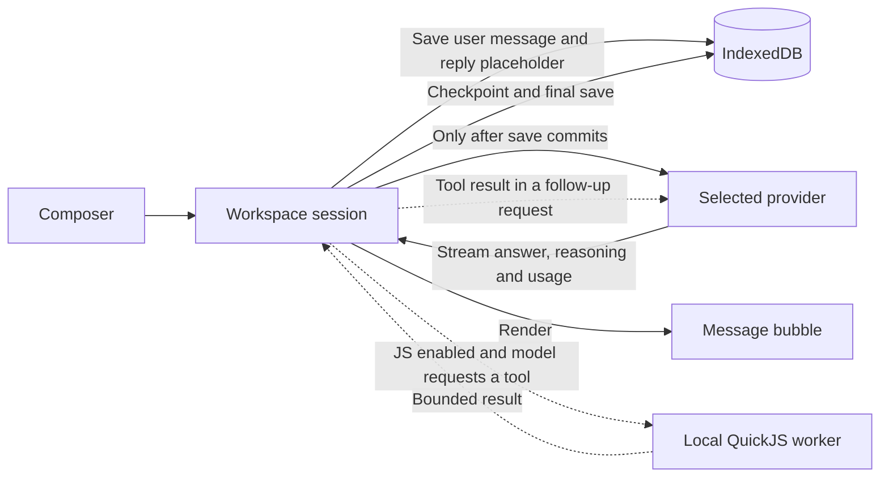

# Luma Chat feature map

Use this map to find a user-facing feature, the code that owns it, and the limits that matter when changing it. It describes `2d73183` plus the workspace changes tracked in [task.md](task.md), not the version installed on a particular device. See the [README](README.md) for setup and the [implementation backlog](docs/ISSUE-BACKLOG.md) for proposed work.

## Follow one reply

The browser contacts the provider directly; there is no application server. On the ordinary path, a failed initial save leaves the draft visible and sends no request. The dotted path exists only for a tool-enabled reply; the worker never receives the provider key. The orchestration lives in [`send` and `runReply`](src/use-workspace.ts).

## Features by user journey

| I want to… | Where and what | Code entry points |
| --- | --- | --- |
| Open or recover my workspace | The themed launch screen waits for local settings, the selected chat and its draft before revealing the UI. Recovery offers retry or explicit reload without clearing data. | [Startup gate](src/startup.ts) · [Storage](src/storage.ts) |
| Find and organize a chat | The sidebar groups pinned, project and recent chats. `Ctrl/⌘ + K` searches locally. Use conversation actions to rename, pin, move, archive or delete; restore a chat from **Archived**. Desktop has a resizable sidebar; mobile uses a drawer. | [Sidebar](src/components/Sidebar.tsx) · [Grouping and search](src/workspace.ts) · [Conversation actions](src/components/WorkspaceActions.tsx) |
| Connect my model | **Settings → AI providers** supports Gemini, OpenAI, Anthropic, OpenRouter and LM Studio. Keys can stay in memory or be saved in a password-encrypted vault. LM Studio tokens are bound to the configured server base URL, including its path. | [Provider requests](src/providers.ts) · [Credential binding](src/credential-destination.ts) · [Encryption](src/crypto.ts) |
| Choose which model answers | Search on-demand catalogs in the composer, or enter a model ID in provider settings. A chat can inherit the global model or pin its own. Retry can reuse the original model selection with current credentials. Catalog listing is not proof of inference access. | [Model picker](src/components/ModelSelector.tsx) · [Model capabilities](src/model-options.ts) · [Configuration precedence](src/request-config.ts) |
| Compose, attach and send | Drafts and attachments belong to each chat. Use the picker, drop files or paste images; files are limited to 5 MiB each. Image input is capability-gated. Desktop Enter sends, Shift+Enter adds a line, and IME composition does not submit. Stop retains partial output. | [Composer](src/components/Composer.tsx) · [Attachment reader](src/attachments.ts) · [Send, stop and retry](src/use-workspace.ts) |
| Explore message branches | Retry replies or edit user messages to create versions. Switch with the version controls, or delete a confirmed subtree. Only the selected path is sent to a model. | [Branch data and migration](src/branches.ts) · [Conversation actions](src/use-workspace.ts) |
| Find a message in a branch | Search returns individual message matches, including hidden branches. Opening a result saves the selected path and focuses the matching message; shared ancestors keep the current path. | [Workspace search](src/components/WorkspaceSearch.tsx) · [Search matching](src/workspace.ts) |
| Read or copy a reply | Answers and available reasoning are displayed separately. Markdown, tables, math and highlighted code render locally. Copy a whole answer as raw Markdown or copy one code block. External images load only on request. | [Rich messages](src/components/RichMessage.tsx) · [Streaming Markdown and URL rules](src/rich-markdown.ts) · [Copy behavior](src/message-copy.ts) |
| Understand response speed or cost | Expand a reply footer for the requested/served model, arrival timings, throughput, tokens, cost and finish reason where available. Missing values show `N/A`; estimates are distinguished from provider reports. | [Response inspector](src/components/ResponseInspector.tsx) · [Provider normalization](src/provider-telemetry.ts) · [Metric calculations](src/response-telemetry.ts) |
| Let a model run a calculation | **JS** opts the next reply into `javascript.execute`. A tool-capable model can request synchronous code in a fresh QuickJS/WASM worker. The card shows code, console output, result and status. Stop cancels execution. | [Tool rounds](src/tool-turn.ts) · [Isolated runtime](src/js-tool-runtime/index.ts) · [Execution card](src/components/ToolExecutionCard.tsx) |
| Inspect what the app is using | The top-bar **Workspace Inspector** has six read-only tabs: Runtime, Context, Configuration, Telemetry, Storage and PWA. Export a sanitized diagnostic summary, not a chat backup. | [Inspector UI](src/components/WorkspaceInspector.tsx) · [Diagnostic export](src/workspace-inspection.ts) · [Session state](src/workspace-state.ts) |
| Back up or restore conversations | **Settings → Local data** exports JSON with conversations, branches, attachments, projects and preferences, excluding the key vault. Branch backups use version 2; version 1 remains importable. Oversized workspaces offer downloadable groups and name conversations that cannot fit. Import previews conflicts, offers skip or replace, and applies optional preferences in the same transaction as the selected records. This screen also requests persistent storage. Confirming **Clear all local data** invalidates outstanding unlocks and backup reads in this tab; a committed clear resets the key form, session keys and import preview. | [Byte-limited export groups](src/backup.ts) · [Import actions](src/use-workspace.ts) · [IndexedDB commit](src/storage.ts) · [Data contracts](src/data-contracts.ts) |
| Reopen offline or update | After production assets are cached, saved chats, drafting, math rendering and the local JS runtime work offline. The installed worker serves one build’s HTML and integrity-pinned assets; a failed install leaves that build in place. Cleanup only removes obsolete builds of the same registration. The version button checks for updates without reloading an active reply. | [Service worker](public/sw.js) · [Precache generation](vite.config.ts) · [Update control](src/pwa-update.ts) |
| Change language or appearance | **Settings → Appearance** supports English, Simplified Chinese, and light, dark or system appearance. Reduced-motion preferences are respected during launch. Chat content is not translated. | [Preferences](src/components/Preferences.tsx) · [Translations](src/i18n.ts) · [Theme](src/theme.ts) |

## Boundaries worth knowing

- **Local history is not local-only inference.** Sending includes user messages, completed assistant answers and their supported attachments. Browsing provider tabs does not change the recipient. Use **Set as default provider** for unpinned chats or explicitly choose a model. Before existing history goes to a new cloud provider, [the sharing dialog](src/components/HistorySharingDialog.tsx) offers to include history, open a blank chat, or cancel. Reasoning, telemetry and raw execution cards are not replayed as ordinary chat history.
- **Stored is not synced.** IndexedDB is the persistent store; the session also contains buffered drafts and in-flight updates. There is no cross-device sync or live tab mirroring. Conversation writes check their last observed revision; on conflict **Save a separate copy** keeps this tab’s work without touching the original. Settings writes merge unrelated preferences against the latest stored record. Finished replies show a separate local-save status. **Retry local save** does not generate another reply. Archive and restore move the row only after the IndexedDB commit.
- **Backup and diagnostics serve different audiences.** Treat backup JSON as private: it includes raw conversation content and provider settings. A backup file is capped at 100 MiB on both export and import. Each file restores atomically; separate group files are independent. Diagnostics omit content, credentials, headers and endpoint addresses.
- **Offline execution is not an offline model.** Cloud inference still needs connectivity; LM Studio needs a reachable server. Tool results go back to the selected model and can trigger another billable request. A tool-assisted reply's footer describes the latest model request, not the cost of the entire turn.

For the rationale behind proposed storage, backup and offline-update changes, see the [engineering roadmap](ROADMAP.md). They are not listed above as implemented features.
