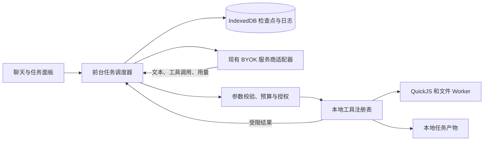

# Luma Chat Browser-first Agent 架构

**状态**：实施前设计。当前代码基线为 `353083d`（v0.2.2）。下文的工具入口、运行预算和恢复界面均为拟议能力。 [产品目标](../goal.md) · [实施顺序](../ROADMAP.md) · [验收清单](../task.md) · [Composer 与 CSV 规格](COMPOSER-CSV.md)

## 1. 用户流程与部署边界

本地工具默认开启，用户用普通发送按钮提交问题。支持函数调用的模型可自动选择已启用的工具。用户选择 CSV 作为本地分析文件后，第一次有效的 CSV 工具调用创建任务，浏览器执行本地步骤并把获准的有限结果交回给同一个服务商。任务卡显示已经发生的操作、暂停原因和可恢复的位置。

首版以 CSV 和表格分析为重点。主流程是选择 CSV、按月汇总、预览生成的表格并主动下载新 CSV。联网工具默认可用。文件工作区支持用户选择单文件或授权目录，按权限级别读取和操作。CSV 分析本身保持只读输入。 [联网工具](BROWSER-NETWORK-TOOLS.md) · [文件访问](BROWSER-FILE-ACCESS.md)

部署沿用静态 GitHub Pages。浏览器负责调度、工具执行和 IndexedDB 持久化，并以现有 BYOK 方式直连用户选择的模型服务。安装后的 PWA 可以离线打开对话、草稿、任务记录和本地工具资源。模型调用仍取决于目标服务可达、CORS 与模型能力。页面冻结、关闭或设备休眠后，只能依赖最近已提交的检查点；Service Worker 继续负责缓存和更新，任务由用户重新打开页面并手动恢复。

## 2. 现有代码与参考实现

| 领域 | Luma 现状 | 拟议演进 |
| --- | --- | --- |
| 模型与工具循环 | 每次回复最多 2 轮、4 次实际工具执行，支持根据结果发起下一次模型请求。 | 普通聊天保留现有行为。当前回复首次请求已授权的 CSV 工具时进入任务循环，使用独立预算和停止原因。 [工具循环](../src/tool-turn.ts) |
| 本地工具 | QuickJS、时间、计算、文本、附件和记忆工具。附件范围沿当前请求历史，记忆写入意图目前由工具说明约束。 | 用确定性策略校验参数和授权。CSV 分析读取选中的附件；文件工作区可访问用户授权的目录；首版任务工具清单不包含本地记忆。 [工具定义](../src/local-tools.ts) · [JS 运行器](../src/js-tool-runtime/) |
| 聊天、分支与恢复 | 发送前保存消息和回复占位；分支选择限定请求上下文；有跨标签页会话写入冲突检查；重载把未完成回复和工具记录标记为中断。 | 在相同的消息分支上关联任务检查点、独占运行权和已完成步骤。 [会话控制器](../src/use-workspace.ts) · [分支](../src/branches.ts) · [存储](../src/storage.ts) · [恢复规则](../src/data-contracts.ts) |
| 服务商协议与诊断 | 工具续接复用各服务商适配器；OpenAI Responses 已有专用重放格式；工具卡片已有阶段、结果、错误和耗时。 | 沿用原生工具协议及工具卡片，添加任务级事件和分轮用量；按适配器能力开放恢复。 [工具协议](../src/provider-tools.ts) · [Responses](../src/openai-responses.ts) |

| 参考 | 参考做法 | Luma 的浏览器实现 |
| --- | --- | --- |
| Pi CLI 会话 | 会话树、活动分支和持久化会话事件。 | 沿消息树投影上下文，在 IndexedDB 按会话和分支保存任务记录。跨分支带入摘要需要用户明确选择。 [Pi Sessions](https://github.com/earendil-works/pi/blob/main/packages/coding-agent/docs/sessions.md) |
| Pi CLI 生命周期 | 注册工具、拦截调用、观察结果及区分运行结束与真正空闲。 | 前台 TypeScript 调度器统一处理预算、权限、事件及停止；标准工具在受限 Worker 或应用能力接口中执行。 [Pi Extensions](https://github.com/earendil-works/pi/blob/main/packages/coding-agent/docs/extensions.md) |
| Pi CLI 上下文压缩 | 保存摘要和保留边界，从会话投影重建上下文。 | 摘要绑定当前分支与源消息范围，在现有 BYOK 请求中按规则使用。 [Pi Compaction](https://github.com/earendil-works/pi/blob/main/packages/coding-agent/docs/compaction.md) |
| Open WebUI 聊天入口 | 在输入区「＋ → Tools」为会话启用工具。原生函数调用由模型决定是否执行。 | 同一个 Composer 和发送按钮，用工具选择控制能力，任务状态随调用出现在回复中。 [工具选择与 Native Function Calling](https://docs.openwebui.com/features/extensibility/plugin/tools) |
| Open WebUI 工具编排 | Python 中间件校验工具、限制调用循环、处理审批和续接。 | 在浏览器内实现同类状态与预算控制，经用户选定的适配器直连；不引入其 Python 后端或服务器插件。 [中间件源码](https://github.com/open-webui/open-webui/blob/main/backend/open_webui/utils/middleware.py) · [服务端工具调用](https://docs.openwebui.com/reference/server-side-tool-calling) |
| Open WebUI 流式界面 | 前端把 SSE 流解析为 UI 可消费的事件。 | 使用 Luma 的现有适配器，在 UI 中用同一张时间线展示模型流、工具、批准和错误。 [前端流解析](https://github.com/open-webui/open-webui/blob/main/src/lib/apis/streaming/index.ts) |

Pi 的终端、项目目录和 npm 扩展，以及 Open WebUI 的服务端任务与插件，是各自宿主提供的能力。Luma 的首版目标是单个浏览器 Agent 处理用户授权的本地任务。

## 3. 调度与状态

1. **发送**。保存用户消息和回复占位，快照记录分支、服务商/API 模式、模型、文件授权及工具清单。已选 CSV 的回复在提交本地记录、取得会话运行权后才向服务商发送获准上下文，预留任务预算。纯文本答复按普通聊天保存。
2. **执行**。收齐原生工具调用并验证工具名称、输入、任务范围和权限。首次通过校验的 CSV 调用在执行前保存任务和检查点，任务从本次回复的第一条模型请求开始计量。每轮检查时间和剩余额度。需要用户确认时保存请求再等待选择。工具结果以原调用 ID 续接，在下一轮模型请求前提交检查点。首版串行执行。
3. **结束**。模型返回最终回复、遇到可恢复限制、出现错误或用户停止时记录原因，保留已完成步骤。最终完成在回复和任务状态写入成功后确认。保存失败时保留当前可见结果并提供「重试保存」，该操作只重试本地写入。

首版任务入口以 CSV 分析为验收场景。联网和文件工作区工具各自沿用普通聊天工具调用与权限规则，并复用统一的工具卡与停止入口；要把它们接入可恢复任务循环，需按同一检查点和预算规则验证。

调度逻辑从 [tool-turn.ts](../src/tool-turn.ts) 演进，接收流式请求、工具执行、预算与存储接口。 [use-workspace.ts](../src/use-workspace.ts) 继续衔接 Composer、聊天状态、停止和更新流程；服务商适配器负责编解码，存储层负责事务和恢复判定。任务组件只根据已发布的事件渲染状态和用户操作。

| 状态 | 触发与后续动作 |
| --- | --- |
| 就绪 / 运行中 | 创建成功后启动，或由用户从可恢复状态继续。显示当前模型或工具步骤。 |
| 等待确认 | 需要扩大附件范围或对外共享额外内容。用户可明确选择范围、拒绝或停止。拒绝产生明确的工具结果，供模型判断能否继续。 |
| 已暂停 | 用户暂停、预算耗尽或暂时断网。保留已提交的边界；恢复前重查权限、预算、凭据和分支。额度耗尽时，用户须确认追加额度才能继续。 |
| 已中断 | 页面崩溃、关闭或失去运行权。开启页面后让用户查看恢复点并选择继续。 |
| 已完成 / 已停止 / 失败 | 保存结果或失败原因。重新执行显式创建新任务；可恢复错误提供从检查点继续的入口。 |

暂停时停止接收下一步，取消正在等待的模型请求或可取消的工具，回到最近已提交的边界；停止还会关闭待审批请求。所有续接公用一个取消信号，迟到的事件必须匹配当前运行代号才可更新 UI 或写入。取消请求后，服务商已经处理的部分仍可能计费。

## 4. 预算、失败与服务商兼容

首版建议值为分析任务 **6 轮模型请求、12 次工具尝试、90 秒活动时间**。选择分析文件后可在发送前查看。计数包含本次回复的首条模型请求、已尝试的失败请求和重试。等待用户确认不计入活动时间。普通聊天沿用 2 轮工具调用和 4 次实际执行的现有边界，QuickJS 的单次资源限制继续独立生效。

- **模型与费用**。按模型调用记录输入、输出及费用，区分服务商上报、估算和未知。请求前基于已知价格检查估算额度，支持时限制输出长度。实时计费不可完全观测，因此费用额度属于发出新请求的控制线；缺少可靠定价或用量时，显式显示未知，配置了费用上限的任务在无法估算下一轮时暂停。
- **调用与重复**。工具尝试、工具批次数量和返回体积都有限制。相同工具、规范化参数和相同输入版本反复出现且无新结果时暂停，说明卡在哪一步。已经完成的调用 ID 不再执行。
- **失败处理**。参数错误或工具超时返回有限、结构化的结果。认证失败、能力不支持或 CORS 失败交给 UI 说明。只有确认尚未发送的请求可以透明重试；服务商是否已经处理无法确认时，提示用户继续可能增加一次模型调用。有副作用的工具依据执行回执处理。
- **协议兼容**。在现有 OpenAI Chat Completions / Responses、Anthropic、Gemini、OpenRouter 与 LM Studio 适配器上使用原生工具格式。预检和首个请求错误共同确认模型能力，覆盖 GPT-6 Luna 已有的工具与推理兼容策略。某个适配器如果无法从检查点重建合法的工具历史，恢复时只能从最近可发送的边界开始并展示原因。

## 5. 工具权限与浏览器工作区

**已确认的选择**：默认使用「操作前询问」，用户可主动选择「完全访问」。联网工具默认可用。用户可选择单文件，也可在浏览器支持时授权目录，目录内支持读取、创建、修改和删除。CSV 分析按只读输入及下载产物设计。

| 权限级别 | 用户体验与授权范围 |
| --- | --- |
| 操作前询问（默认） | 读取用户已选择的 CSV 并在本地计算可自动进行。访问新资源、联网和写入等需授权操作之前展示目的、目标和拟执行动作，由用户允许或拒绝。CSV 数据发送给模型仍按发送前的数据范围确认执行。 |
| 完全访问 | 用户主动选择后，对浏览器已经授予且应用已实现的文件和网络能力自动执行，界面显示实际授权范围并提供撤销。选择该级别前展示可用范围；网页仍需完成浏览器要求的授权。 |

权限选择放在 Composer 的工具菜单及设置中，两个入口显示同一状态。新用户和没有该设置的旧用户默认「操作前询问」；用户更改后在本设备持久保存，之后可切回或撤销。任务发送时记录权限快照；收紧权限应立即阻止后续动作并关闭待执行授权，已经发出的请求或完成的操作按实际结果显示。扩大权限只影响用户变更后的后续调用，不能重放已拒绝的动作。

浏览器无法授予网页操作系统级的无限访问。目录访问取决于浏览器、用户选择和操作系统权限；联网仍受 CORS 等规则限制。QuickJS 当前没有文件、网络或浏览器 API 桥接，任何扩展均须通过应用提供的受限工具接口。浏览器权限被撤销、恢复或更新后，重新核验实际能力。用户在界面上的选择不能扩大浏览器授予的权限。

注册表为每个动作声明名称、参数验证、超时、返回上限、所需授权、是否有副作用、是否可取消，以及结果是否允许发给模型。策略由应用根据实际名称和参数执行，模型输出、附件和网页文字仅作为数据。授予范围与目标地址、任务、分支和资源 ID 绑定；用户可以拒绝或撤销，修改收件服务商时重新确认。预览向用户展示数据类别、将接收它的服务商和拟执行的变更。

一次性批准绑定调用 ID、规范化参数和资源修订，批准后执行前再校验。CSV 分析请求只发送允许的列信息和结果。源 CSV 和未选附件从模型请求及工具上下文中分别过滤，含同一文件的普通附件路径也适用。 [CSV 数据流](COMPOSER-CSV.md#csv-输出与数据流)

| 工具范围 | 首版权限策略 |
| --- | --- |
| CSV 结构检查与汇总 | 首版使用有确定参数的本地操作，由文件 Worker 解析与计算。日期和数值列唯一匹配时自动继续，并展示所选列；多候选、无匹配或请求不明确时等待用户选择。 |
| 联网 | 默认提供网页读取；搜索依赖用户配置可从浏览器访问的搜索 API。默认权限下每次联网前询问，完全访问按浏览器实际能力执行。 [联网工具设计](BROWSER-NETWORK-TOOLS.md) |
| 源文件 | 指定一份已选 CSV，在浏览器内读取。模型可见的数据范围限列信息、计数和获准的汇总。 |
| 文件工作区 | 用户选择的单文件可读取，授权目录按实际浏览器权限支持读取、创建、修改和删除。操作前询问为默认，完全访问由用户主动选择。 [文件访问设计](BROWSER-FILE-ACCESS.md) |
| 本地记忆 | 首版任务禁止列举、读取、写入和删除。后续单独评估，届时持久变更须预览并逐次批准。 |
| 文件产物 | 将汇总表保存为任务内的限量数据。预览和 CSV 下载使用同一份数据，由用户点击下载。CSV 分析不写回原文件。 |

模型凭据只在模型请求适配器可用；搜索服务凭据只在对应适配器可用。任务日志和导出排除密钥、请求头与设备授权；诊断仅包含状态、耗时等非内容字段。工具由项目代码注册，联网由应用层接口按权限执行。QuickJS 沙箱继续与网络隔离。

## 6. 检查点、并发与数据生命周期

| 拟议记录 | 内容 |
| --- | --- |
| `AgentRun` | 版本、任务 ID、会话 ID、起始消息/分支 ID、回复 ID、目标、非密钥配置、预算、状态、当前检查点、所有者代号。 |
| `AgentEvent` | 任务内递增序号、事件类型、时间、轮次、调用 ID、结构化结果或引用。按轮次聚合用量与耗时；限制总大小并为用户保留清理入口。 |
| `AgentCheckpoint` | 最近完整、可续接的模型与工具边界、已提交调用回执、适配器所需的受限续接数据、剩余预算、分支修订。 |
| `AgentArtifact` | 关联任务的本地文本/表格产物或摘要，带内容类型、体积、来源和保留期限。 |

- **存储**。先使用新增的版本化 IndexedDB 记录，保留既有消息、分支和备份读写契约。涉及消息与任务收尾的写入放同一事务。任务详情按需加载，不阻塞首屏。删除所属分支或清除本地数据时同时删除相关运行、批准和产物，并阻止迟到回调重建记录。首版备份仍按现有格式保存聊天；以后若增加任务备份，只导入静态内容和完成记录，明确授权和运行权都留在本机。
- **跨标签页**。同一会话同时只允许一个任务写入。用 IndexedDB 事务取得有过期时间的运行所有权并生成单调递增代号，结合现有会话修订检查提交。活动页面续期，标签页消息只用于同步 UI。所有权因关闭或挂起失效后，由新页面显式接管；每次调用前验证所有权，旧所有者迟到的结果写入会被拒绝。已经发出的模型请求仍可能由服务商完成。
- **恢复与副作用**。恢复时检查分支存在且检查点未失效。已落盘的工具结果在适配器允许时用于匹配原调用，避免重跑；普通计算可在用户选择恢复后从最近稳定边界重做。产物记录与生成回执同事务提交，恢复后显示已保存的预览和下载入口。若将来接入无法与 IndexedDB 原子提交的动作，结果不明的动作标记为「需核对」，不能因超时或刷新而自动重放。
- **PWA 更新**。复用现有更新前的保存检查。运行中等待保存边界，用户也可主动暂停并确认已保存再应用更新。若移动设备冻结页面导致末轮来不及保存，恢复界面标记未确认的步骤，不依赖关闭事件完成写入。

## 7. 上下文、界面与交付

模型上下文从当前有效分支生成，包含本轮任务目标、已授权数据与必要续接记录。长任务先显示估算上下文余量，后续增加按分支保存的压缩摘要。摘要带来源范围与生成模型；保留最近完整消息和工具调用/结果对。摘要视作上下文数据，绑定源范围与修订，源消息变化后失效。使用云模型生成摘要时，遵循同一个收件服务商和授权规则，摘要调用消耗预算。

Composer 的「＋ → 工具」统一管理工具选择。总开关沿用已存在的默认开启和持久化规则，用户手动关闭后不会自动打开；CSV 分析默认可用，单项选择按会话保存。未选择 CSV 时不提供该分析工具。复用工具卡片查看输入、结果、耗时和错误，可用键盘完成选择、授权与恢复。任务状态与「已保存」分开显示，桌面、移动和独立 PWA 模式都能在任务卡上找到暂停与停止。新增界面文案覆盖英文、简体中文、马来语。 [Composer 与 CSV 规格](COMPOSER-CSV.md)

| 阶段 | 交付与验收 |
| --- | --- |
| P0 · 可控任务循环 | 模型自动选择当前启用的工具，首次有效 CSV 调用创建任务。用模拟服务商验证多轮汇总，每步可见，达到预算后停止新调用。 |
| P0 · 文件权限与恢复 | 单文件读取和用户授权目录操作按权限策略执行。验证拒绝后不扩大访问范围、刷新后显式恢复、旧标签页不能提交、结果不明的写入不自动重放。 |
| P0 · 表格预览与下载 | 用固定 CSV 样例验收按月汇总结果。预览的新表格与下载的 CSV 数据一致，桌面和手机均可完成。 |
| P1 · 上下文 | 添加按分支摘要与更详细的用量显示，评估本地记忆权限。 |
| P2 · 扩展评估 | 依据真实任务验证受限扩展的价值，再评估外部集成或多 Agent。移动浏览器后台持续执行不作为交付目标。 |

拟议测试应优先使用现有 mock 服务商覆盖取消、错配调用 ID、超额、权限拒绝、事务失败、旧备份、跨标签页和隐含分支数据隔离。发布前检查生产子路径上的 Worker，并按 [移动端实机验证清单](MOBILE-DEVICE-CHECKLIST.md) 记录 iOS 和 Android 浏览器及安装模式的暂停、恢复、配额不足和更新流程。真实模型兼容性由单独的验证记录标明。具体任务和验收条件见 [task.md](../task.md)。
